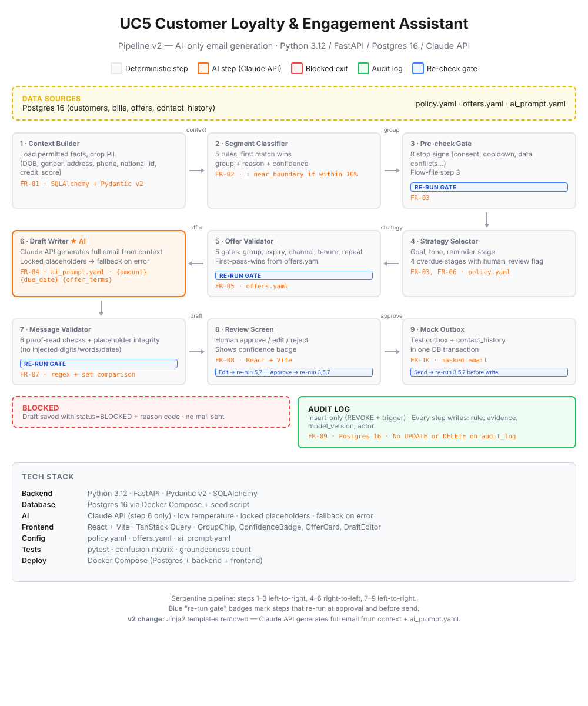

# Engagement Assistant — Reviewer Console (frontend)

React + TypeScript + Vite frontend for the **Customer Loyalty and Engagement Assistant** use case.
It is the human-review layer (FR-08) on top of a backend that does classification, deterministic
policy checks and LLM drafting. Nothing is sent without a reviewer approving it.

The console is step 8 of the pipeline:



## Screens

| Route | Screen | Covers |
| --- | --- | --- |
| `/` | Review queue: segment, confidence, strategy, checks, status; filter + search | FR-02, FR-03 |
| `/review/:customerId` | Review workspace: evidence, reason codes, strategy, grounded draft, 11 checks, rubric, approve / edit / reject | FR-01–FR-08 |
| `/blocked/:customerId` | Refused case: failed checks with reason codes, locked send, escalation | FR-07, FR-10 |
| `/policy` | Segment rules, offer catalogue, reminder stages, message-validator rules, tone-forbidden words | Policy config |
| `/audit` | Evaluation metrics, confusion matrix, scenario coverage, audit log, JSON export | FR-09, evaluation |

## Run it

```bash
npm install
cp .env.example .env      # optional
npm run dev               # http://localhost:5173
```

By default the console talks to the **real backend** (FastAPI on `:8000`). The dev server proxies
`/api/*` to `VITE_BACKEND_URL` and adds `X-Admin-Key` from `ADMIN_KEY` in `.env`, so the key never
reaches the browser bundle. Set `VITE_DATA_SOURCE=mock` to run on the synthetic data in
`src/data/mock.ts` with no backend.

## End to end

```bash
# repo root: .env with DATABASE_URL, ADMIN_KEY and LLM settings (or MOCK_LLM=true)
uvicorn app.main:app --port 8000
# ui/: .env with the same ADMIN_KEY
npm run dev                # open http://localhost:5173 and press "Classify new batch"
```

`src/api/backend.ts` maps the backend's routes onto the console types:

| Console call | Backend route |
| --- | --- |
| generate | `POST /engage/batch` with `limit: 8`, repeated until `remaining` is 0; the button shows progress and the queue refreshes after each chunk |
| queue | `GET /drafts?full=true` (every draft with details in one call; the page and the sidebar share it) |
| review case, blocked case | `GET /drafts?full=true&customer_id=…`, then `GET /audit/:trace_id` (step-1 evidence) and `GET /policy` in parallel |
| revalidate | `POST /drafts/:id/edit` (re-runs gates 5 and 7) |
| approve / reject | `POST /drafts/:id/approve` + `POST /drafts/:id/send` (re-run gates 3, 5, 7), `POST /drafts/:id/reject` |
| policy | `GET /policy` (the YAMLs in `config/` plus the offer catalogue) |
| evaluation | `GET /evaluation` (steps 1-5 vs `data/dataset/ground_truth.csv`, plus review stats) |
| audit log | `GET /audit` (newest audit rows, evidence left out) |

All console shapes are defined in **`src/types.ts`**; the adapter is the only place that knows the backend's field names.

### Grounding display

`EmailDraft.paragraphs[].spans[]` carries `kind: 'plain' | 'grounded' | 'policy'` and an optional
`evidenceKey`. The adapter builds the spans: every value that filled a locked placeholder (name, plan,
amount, date, points) is marked grounded, and the offer terms are marked as a policy block. The UI
highlights grounded facts in green and policy-controlled blocks in purple.

### Guardrails the UI enforces (the backend must enforce them too)

- Approve is disabled while any check is `fail`, while editing, or while re-validating.
- Any reviewer edit triggers `/revalidate` before approval is possible.
- Blocked cases have no approve path; Send is permanently disabled on that screen.
- Send only follows a successful approve: the adapter calls `/send` right after `/approve`, and the
  backend re-runs gates 3, 5 and 7 before writing the mock outbox row.
- A refused action (for example a 409 because the checks no longer pass) is shown as an alert, and the
  case reloads.
- `useAsync` applies only the newest response, so a slow or duplicate request (React StrictMode loads
  twice in development) can't reset a reviewer's edit.

## Project structure

```
src/
  api/client.ts        mock + http implementations behind one interface
  api/backend.ts       adapter from the FastAPI routes to the console types
  api/useAsync.ts      small data-loading hook (latest response wins)
  components/          Sidebar, Icon, chips, badges, stat cards
  data/mock.ts         synthetic customers, policy, evaluation, audit log
  pages/               QueuePage, ReviewPage, BlockedPage, PolicyPage, AuditPage
  styles/global.css    design tokens (colors, type) and all component styles
  types.ts             data contract
```

Design tokens (IBM Plex Sans/Mono, ink `#14171F`, accent teal `#0B5E5E`, segment color pairs)
live at the top of `global.css`.

All numbers and customers in `mock.ts` are synthetic placeholders; in the default `http` mode every
page shows live backend data instead, including the evaluation.
